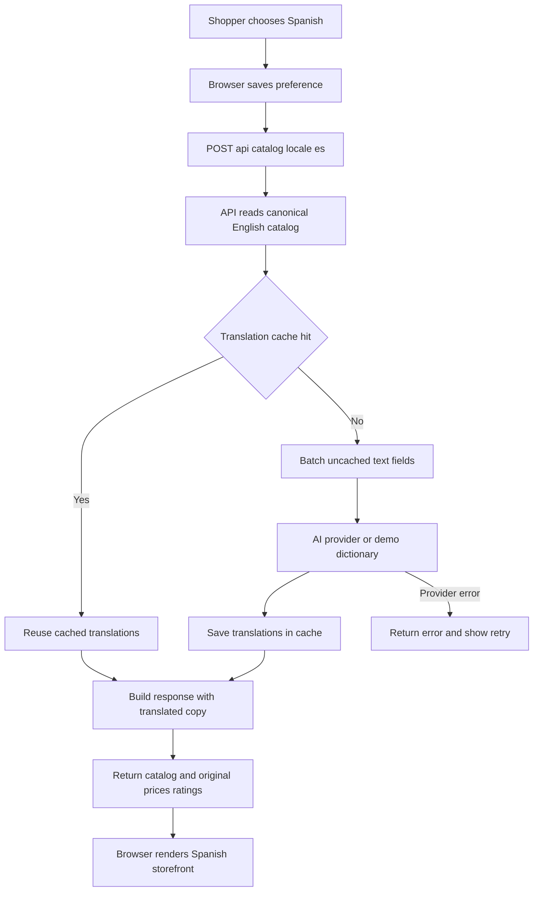

# Catalog translation proof of concept

## Proof-of-concept evaluation complete

The end-to-end proof of concept has been exercised with a real AI provider: one cold request translated 23 distinct product strings in a single provider call in about 4.4 seconds, and a repeat request served all 24 displayed text fields from cache without another provider call. Automated checks confirmed response shape, cache reuse, and preservation of product IDs, prices, ratings, and review counts.

This is sufficient to demonstrate that opt-in, on-demand catalog translation with caching is technically feasible for a small sample. It is not evidence of marketplace-scale cost or performance, and the sample translations have not been independently reviewed by a fluent Spanish speaker. The next meaningful evidence requires representative catalog data and a controlled pilot; further changes to this toy storefront alone cannot establish production readiness.

## What the proof of concept contains

The dependency-free storefront keeps English catalog data canonical and translates product text only when Spanish is requested. It demonstrates language preference, a server-side provider boundary, batched translation, and a content-hash cache. The bundled dictionary is only a fallback demo fixture; the real-provider evaluation is described above.

## Run locally

Requires Node.js 20 or newer. On Ubuntu, install Node.js and npm, then run:

```bash
npm start
```

Open <http://localhost:3000>. Use the language control in the header to switch locales. The preference is kept in this browser's local storage. Without credentials, the UI explicitly labels output as a limited demo dictionary; it can translate the sample catalog but is not AI.

To evaluate real model-backed translation, first add API credits as described below, then run the platform-specific helper. It prompts for the API key without echoing it; do not put the key in browser code or a source file.

Create an API key from your OpenAI Platform account at [platform.openai.com/api-keys](https://platform.openai.com/api-keys). API billing is separate from a ChatGPT subscription. A personal Platform account has an API billing workspace (the UI may call it an “organization”); you do not need a company or team account. Open [API billing settings](https://platform.openai.com/settings/organization/billing/), select the workspace/project associated with your key if prompted, add a payment method, and purchase prepaid credits. If you just added credit but still see a quota error, verify the balance and that the key belongs to the selected workspace/project. OpenAI's prepaid credits expire after one year and are generally non-refundable; see [prepaid billing details](https://help.openai.com/en/articles/8264644-setting-up-and-managing-prepaid-api-billing). Keep the key private: enter it only in your local terminal prompt, do not paste it into chat, source files, screenshots, or commits. The helper scripts do not save it to a file or shell profile.

Alternatively, run the PowerShell helper and enter the key at its hidden prompt. From a PowerShell terminal in this project folder:

```powershell
.\evaluate.ps1
```

If your prompt looks like `C:\...>` (Command Prompt, not PowerShell), launch it this way instead:

```cmd
powershell.exe -NoProfile -File ".\evaluate.ps1"
```

It runs the same evaluator with the default model and restores the terminal's previous API-key/model environment values afterward. To select a different compatible model from PowerShell, pass `-Model "model-name"`. If your organization's PowerShell policy blocks local scripts, follow its approved process rather than weakening the policy.

For Ubuntu/Linux, run the Bash helper from the project folder and enter the key at its hidden prompt:

```bash
bash ./evaluate.sh
```

Pass an optional model name as the first argument, for example `bash ./evaluate.sh gpt-4o-mini`. The key is passed only to the evaluator process and is not saved in your shell profile. Node.js and npm are required.

The server calls an OpenAI-compatible Chat Completions endpoint. Override `OPENAI_API_URL` for a compatible gateway. Provider errors are returned to the client rather than silently replaced with demo output. The API response and page status expose the selected provider/model, provider latency, request latency, cache hits, and whether a provider call was made.

Run unit tests with `npm test`. To run a cold-then-warm end-to-end evaluation against the configured provider, use:

```powershell
npm run evaluate
```

The evaluator starts a local server, requests the sample catalog twice, checks that catalog text changes, structured facts stay unchanged, and the repeat request does not call the provider again. It prints timings, cache behavior, and sample output as JSON. Without credentials, it evaluates only the fixed demo dictionary. With a real provider, it checks response behavior but does **not** grade translation fluency or factual correctness; have a fluent Spanish reviewer assess the printed samples before drawing quality conclusions. Live provider use may incur API charges.

## What the prototype demonstrates

- The catalog's English copy and non-linguistic product facts remain canonical.
- The browser sends a locale preference; the server translates all customer-facing catalog text in one batch on a cache miss.
- Repeated requests reuse SHA-256-keyed translations. The sample cache is in-memory, so it is intentionally lost on restart.
- The AI credential stays on the server. Provider/model details can be swapped behind the translator boundary.
- Validation and provider failures are visible to the caller.
- Request telemetry exposes provider/model, cold/warm provider calls, translated field counts, cache hits, and response timings.

## Sample requests through the system



For example, the browser sends this request when the shopper's saved preference is Spanish:

```http
POST /api/catalog HTTP/1.1
Content-Type: application/json

{"locale":"es"}
```

The first request can populate the cache and returns the catalog with Spanish text. The same request again reuses cached strings. The response includes a `translation` object with provider/model and cold/warm metrics. In both responses, values such as product IDs, prices, ratings, and review counts remain sourced from the original catalog. With no provider key, the translator box above is the limited demo dictionary; with `OPENAI_API_KEY`, it is the configured AI provider.

## Recommendation for a large marketplace

Use a **hybrid**, not a one-time full-catalog translation and not uncached live AI for every page view:

1. Keep source-language catalog data as the system of record, with stable product and field identifiers and source revision/version.
2. On a cache miss, translate requested fields asynchronously or in a batched request. Serve a deliberate source-language fallback or a loading state according to the product's UX policy; do not block critical browsing on an external model.
3. Persist localized results by product, field, target locale, source revision, and translation-policy/model version. Invalidate only affected fields when source copy changes.
4. Pre-translate and human-review high-traffic, high-risk, regulated, and conversion-critical copy. On-demand translation plus caching is a good fit for the long tail.
5. Keep prices, SKUs, dimensions, safety facts, brand names, and other structured values out of free-form translation. Measure quality, latency, cost, cache hit rate, and user corrections before expanding.

For a Java client, expose this behind a language-neutral REST service and implement the production translator/cache in the client's standard Java service stack (for example, Spring Boot). This prototype uses Node only to be runnable with minimal local setup; the API boundary and storage strategy do not depend on it.

## Prototype limitations

- The demo dictionary covers only these sample product strings and now fails explicitly for any unmapped text. The AI integration does not include production-grade retries, durable storage, rate limiting, privacy review, moderation, human QA, or provider-specific structured-output guarantees.
- Production cache keys should include source content revision, locale, policy/prompt version, and model version; the prototype hashes source text and scopes cache by provider/model and locale.
- Product copy translations need locale-aware review and formatting, and should never alter authoritative product claims.

## What remains before a production decision

The proof of concept has answered “can this work?” Remaining work is validation against the client's real requirements, not more demo features:

1. **Translation quality:** have fluent Spanish reviewers score a representative, risk-stratified sample (titles, descriptions, specifications, claims, seller-provided copy); record factual errors and set acceptance thresholds.
2. **Scale and economics:** benchmark representative catalog sizes and concurrent traffic; estimate cold-miss rates, provider tokens/cost, p50/p95 latency, cache hit rate, and behavior under provider throttling/outages.
3. **Production design:** implement within the client's Java service stack; choose durable cache/storage, source-version invalidation, async fill/fallback UX, batching limits, timeouts, retries, rate limits, observability, and rollback.
4. **Risk and operations:** complete security/privacy/vendor review for catalog data sent to the provider; define handling for regulated/safety claims, human escalation, monitoring, and incident response.
5. **Controlled pilot:** launch behind a feature flag to a small consenting audience or limited category/locale. Compare quality, conversion, support contacts, latency, and cost against agreed thresholds before expanding.

Only after those gates pass should the client decide whether to expand to a broader rollout. A full marketplace launch is not required to learn the next things; a representative offline evaluation and limited pilot are the appropriate next steps.
